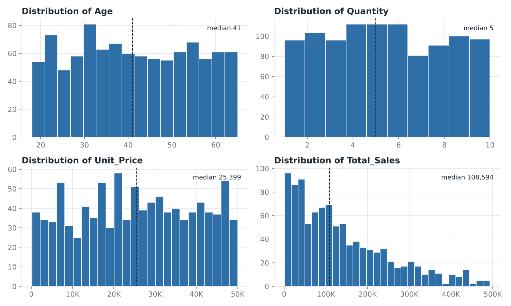
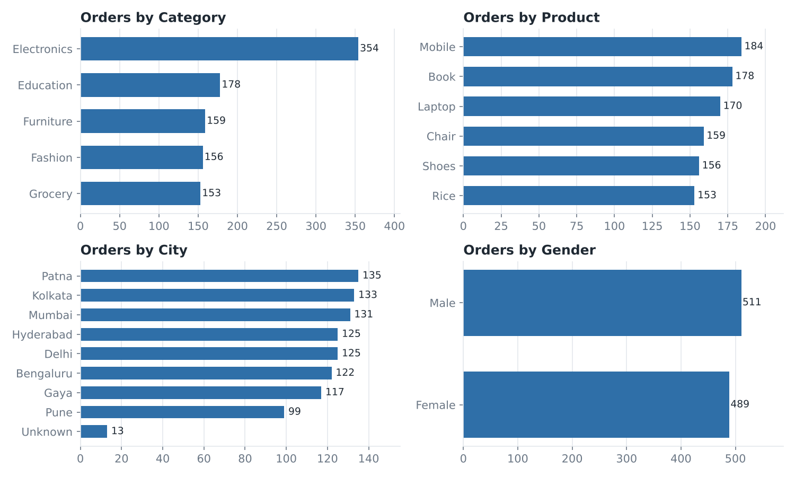
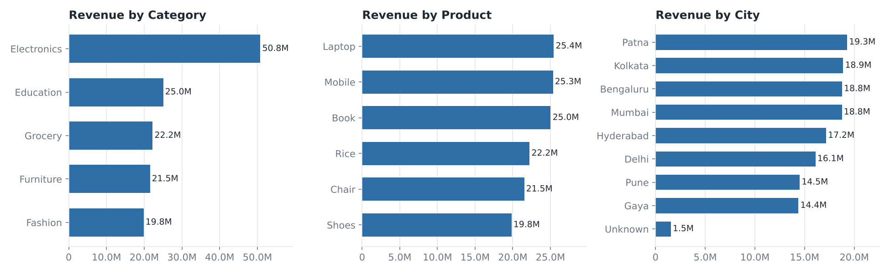
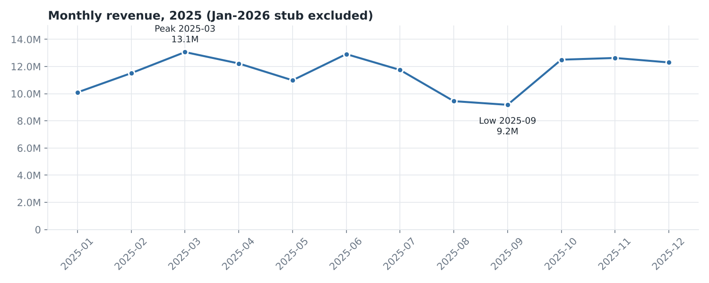
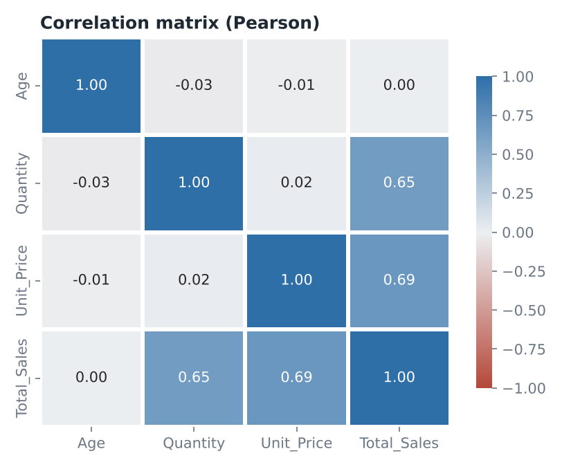
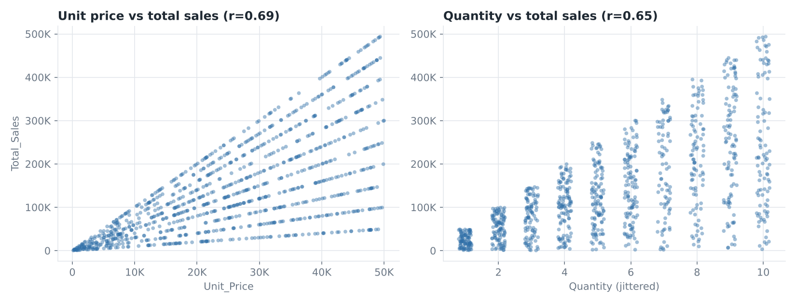
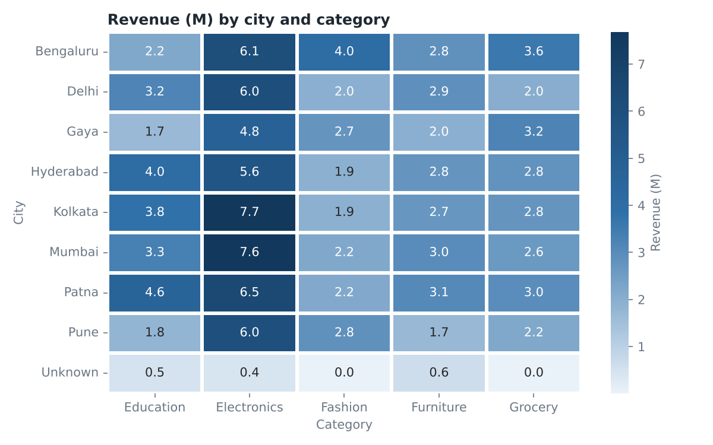
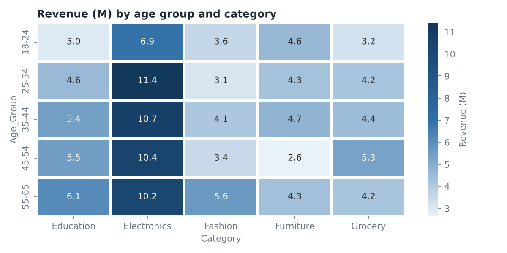
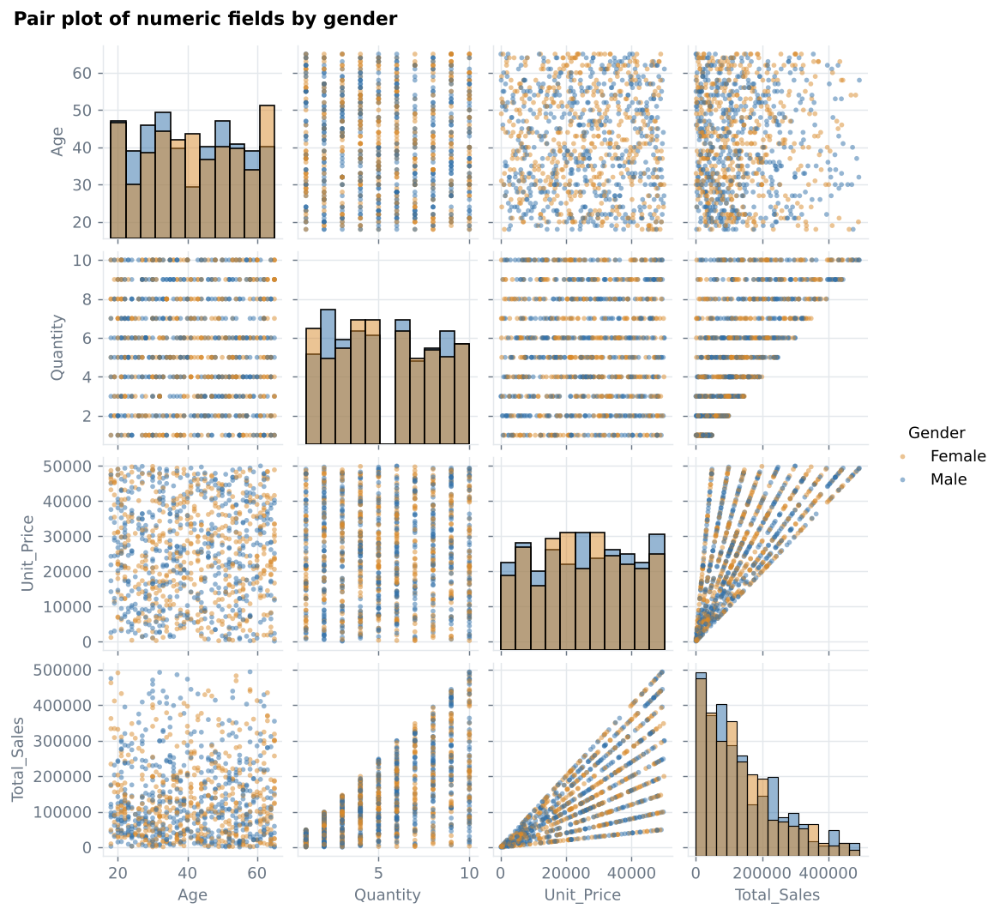
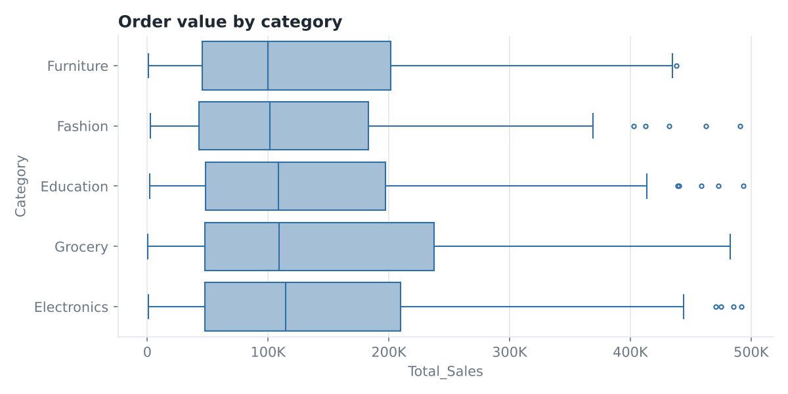

# Task 2 – Exploratory Data Analysis & Business Intelligence
**Dataset:** ApexPlanet sales data (cleaned) · 1,000 orders · 1 Jan 2025 – 1 Jan 2026 · 12 columns
**Currency:** not stated in the data; the 8 cities are Indian, so figures are read as INR (₹). Change if your data dictionary says otherwise.

## 1. Data overview and quality notes
| Item | Finding | Handling |
|---|---|---|
| Missing `Age` | 20 rows (2.0%) | Left blank; excluded from age analysis only |
| Missing `City` | 13 rows (1.3%) | Labelled `Unknown` (₹1.5M revenue) |
| `Order_ID` not unique | 992 distinct IDs for 1,000 rows (each ID repeats up to 9 times, 120 rows apart, all with different customers/dates/products) | Treated as an ID-generation artefact, not duplicate orders. Row-level key `order_key` used in SQL |
| `Customer_ID` ↔ `Customer_Name` | One ID maps to up to 3 names | `Customer_ID` used for customer analysis; names ignored |
| `Total_Sales = Quantity × Unit_Price` | Holds for all 1,000 rows | No correction needed |
| Jan 2026 | Only 5 orders (data ends 1 Jan 2026) | Excluded from monthly trends so it does not look like a collapse |
| Exact duplicate rows | 0 | – |

## 2. Descriptive statistics and univariate analysis
| Field | Mean | Median | Std | Min | Max | Skew |
|---|---|---|---|---|---|---|
| Age | 41.4 | 41 | 13.8 | 18 | 65 | 0.04 |
| Quantity | 5.4 | 5 | 2.8 | 1 | 10 | 0.06 |
| Unit_Price | 25,487 | 25,399 | 14,179 | 146 | 49,998 | -0.03 |
| Total_Sales | 139,399 | 108,594 | 114,100 | 437 | 493,678 | **0.99** |

- `Age`, `Quantity` and `Unit_Price` are roughly **uniform** (skew ≈ 0). Customers are spread evenly from 18 to 65.
- `Total_Sales` is **right-skewed** (mean ₹139K > median ₹109K) because it multiplies two uniform fields. The 100 largest orders (10%) bring in 27.6% of revenue. Use the median for a "typical order".
- Gender is balanced (Male 51.1% / Female 48.9% of orders). Orders are spread evenly over 8 cities (Pune lowest, 99 orders) and 6 products (153–184 each).

- **Electronics is 36.4% of revenue (₹50.8M)** only because it holds two products (Laptop ₹25.4M, Mobile ₹25.3M). Per product, Laptop, Mobile and Book (₹25.0M) are level. Fashion (Shoes, ₹19.8M) is lowest.
- By city, Patna (₹19.3M), Kolkata (₹18.9M), Bengaluru (₹18.8M) and Mumbai (₹18.8M) lead. Pune and Gaya are lowest (~₹14.4–14.5M).
- Men account for ₹72.5M (52%) of revenue and women ₹66.9M (48%).

## 3. Time trend

Monthly revenue ranges from ₹9.2M (Sep) to ₹13.1M (Mar). There is a mid-year dip (Aug–Sep, about −20% from July), then a recovery of +36% in October. Q4 held steady at ~₹12.3–12.6M a month, with December having the most orders (98). There is no clear long-run growth trend; revenue is flat with seasonal swings.

## 4. Multivariate analysis and correlation

- `Total_Sales` correlates with `Unit_Price` (0.69) and `Quantity` (0.65). This is expected, since it is their product.
- **`Age` has no relationship with anything** (|r| ≤ 0.03), and `Quantity` and `Unit_Price` are independent of each other (0.02).
- The task mentions "marketing spend vs sales", but this dataset has no marketing field, so I used the equivalent price and quantity pairs.

- Electronics is the top category in every named city, strongest in **Kolkata (₹7.7M) and Mumbai (₹7.6M)**.
- Education over-indexes in Patna (₹4.6M) and Hyderabad (₹4.0M). Fashion is strongest in Bengaluru (₹4.0M). Furniture is weakest in Pune (₹1.7M).
- By age, the strongest groups are men 25–34 (₹16.9M), women 55–65 (₹16.2M) and women 35–44 (₹15.7M). The weakest is men 18–24 on order value (₹129K per order, against ₹164K for women 18–24).

Average order values are similar across categories (₹127K Fashion to ₹145K Grocery), so category revenue differences are driven by **order count**, not basket size.

## 5. Repeat customers
947 unique customers placed 1,000 orders. Only **52 customers (5.5%) ordered more than once**, and none more than 3 times. Retention is the biggest unexplored opportunity in this data.

## 6. Key insights
1. Revenue of ₹139.4M comes from 1,000 orders at a mean ₹139K and median ₹109K per order.
2. Electronics drives 36% of revenue through two products; the other four products are level at 14–18% each.
3. Revenue is seasonal and flat, with an Aug–Sep trough and a strong Q4 recovery.
4. Revenue depends on order value (price × quantity). Age does not predict spend.
5. Kolkata, Mumbai and Patna are the strongest cities, and Pune and Gaya are the weakest.
6. Only 5.5% of customers repeat, so repeat purchase and loyalty are the main growth lever.

## 7. Caveats
- Unit prices run from about ₹150 to ₹50K for every product, including Rice and Books, so this looks like **synthetic data**. Treat the patterns as a demonstration of method, not as real market findings.
- Most variables are uniformly distributed, so correlations and segment differences are small and may not be statistically significant (no hypothesis tests were run).

## 8. Files
`sql/queries.sql` · `sql/SQL_queries_and_results.md` · `sql/q*_result.csv` · `charts/` · `Dashboard_Mockup.pptx` · `eda.py` · `run_sql.py`
